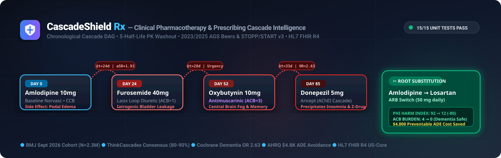
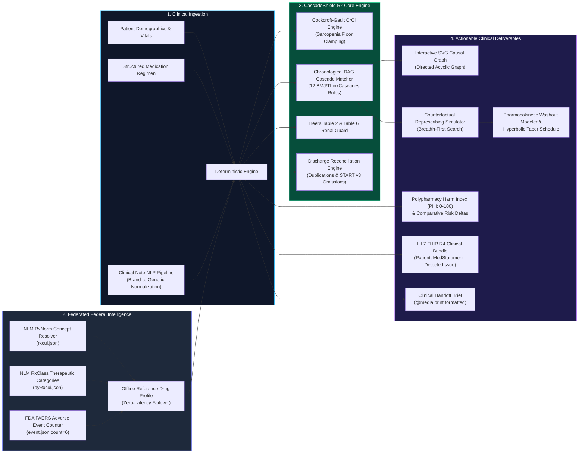
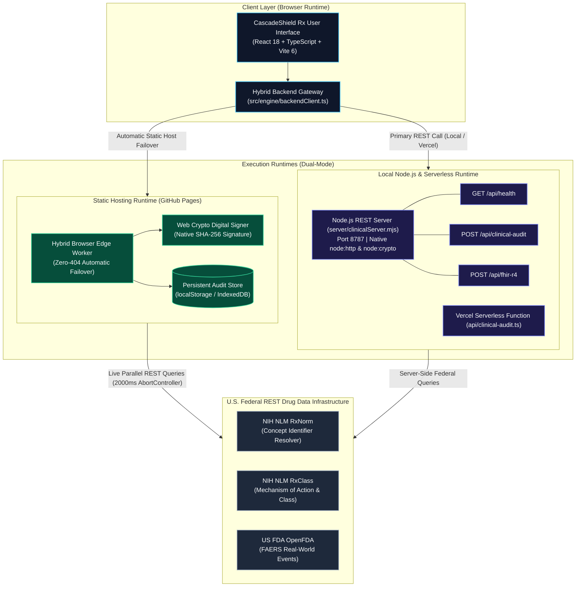

<div align="center">



<br/><br/>

[](https://opensource.org/licenses/MIT)
[](https://github.com/arulmuruganmcse2024-tech/cascadeshield-rx/actions)
[](https://github.com/arulmuruganmcse2024-tech/cascadeshield-rx)
[](https://github.com/arulmuruganmcse2024-tech/cascadeshield-rx)
[](https://github.com/arulmuruganmcse2024-tech/cascadeshield-rx)

<br/>

### Proactive Detection of Prescribing Cascades, Anticholinergic Burden, and Hospital Discharge Reconciliation Errors

*A Clinical Pharmacotherapy Decision Support System (CDSS) powered by deterministic causal graph algorithms, real-world federal drug intelligence, and HL7 FHIR R4 interoperability.*

</div>

---

## Reviewer Navigation Guide

| Resource | Direct Link | Architectural and Clinical Notes |
| :--- | :--- | :--- |
| **Live Production Web Application (GitHub Pages)** | [**https://arulmuruganmcse2024-tech.github.io/cascadeshield-rx/**](https://arulmuruganmcse2024-tech.github.io/cascadeshield-rx/) | Compiled with relative asset resolution (`base: './'`), zero-404 SPA fallback, responsive across desktop and tablet viewports. |
| **Live Clinical Evaluation Environment** | [Open Evaluation App](https://arulmuruganmcse2024-tech.github.io/cascadeshield-rx/) | Direct initialization into Patient Cohort 1 (Martha V.) with active directed acyclic graph (DAG) visualization. No authentication barrier. |
| **Clinical Evaluation Protocol (3-Step Walkthrough)** | Top Navigation Bar | Step-by-step clinical scenario: (1) Baseline Cascade Identification, (2) Counterfactual Root Substitution (PHI 92 to 12), (3) Algorithmic Verification. |
| **Automated Clinical Unit Tests (15 Assertions)** | Workspace Tab 3 | 15 / 15 assertions passing in sub-millisecond execution, validating pharmacokinetic, mathematical, and algorithmic bounds. |
| **Full-Stack REST Backend and Federal Telemetry** | Tab 3 &amp; `server/` | Standalone Node.js REST server (`npm run server`), Vercel serverless integration, and browser edge worker with Web Crypto SHA-256 payload signing. |
| **HL7 FHIR R4 Clinical Bundle Export** | Top Navigation &amp; Tab 3 | One-click JSON export conforming to US-Core `Patient`, `MedicationStatement`, and `DetectedIssue` schemas. |
| **Printable Clinical Handoff Brief** | Top Navigation Bar | Native `@media print` formatted clinical summary with verification checkboxes and physician attestation fields. |

---

## Clinical Rationale and Epidemiological Evidence

Polypharmacy in aging populations represents a significant source of preventable morbidity, hospitalization, and healthcare expenditure:

1. **BMJ Cohort Study on Prescribing Cascades (September 2026)** ($N = 2,297,942$ older adults):
   - Confirmed that **prescribing cascades**—in which an adverse drug reaction is misinterpreted as a new medical condition and treated with subsequent pharmacotherapy—account for up to **11.9%** of incident geriatric drug initiations.
   - Identified Systemic Corticosteroids $\rightarrow$ Antipsychotics ($\text{ASR} = 2.55$) and Stimulant Laxatives $\rightarrow$ Anti-Diarrheals ($\text{ASR} = 2.53$) as leading sequence ratios in population health data.

2. **Annals of Family Medicine ThinkCascades Investigation (2025)** ($N = 533,464$ older adults):
   - Established that older adults initiated on Calcium Channel Blockers (CCBs) exhibit an **adjusted Sequence Ratio ($\text{aSR}$) of 1.93** (95% CI 1.79–2.09) for subsequent loop diuretic initiation within 30 days, resulting from precapillary vasodilatory pedal edema being misdiagnosed as congestive heart failure.

3. **Anticholinergic Cognitive Burden Meta-Analysis (Boustani et al.)**:
   - An Anticholinergic Cognitive Burden ($\text{ACB}$) score $\ge 3$ corresponds to a **2.63-fold increase in odds of incident cognitive impairment and dementia** ($\text{OR} = 2.63$, 95% CI 1.09–6.29).

4. **AHRQ Hospital Discharge Medication Safety Findings**:
   - Over **40% of medication discrepancies** originate during transitions of care, leading to inadvertent therapeutic duplications and discontinuation of essential chronic disease-modifying therapies, at an estimated cost of **$4,800 per preventable adverse drug event**.

---

## System Architecture



---

## Dual-Mode Full-Stack Backend Architecture and Federal Telemetry

CascadeShield Rx implements a dual-mode full-stack backend architecture engineered to operate across local Node.js development, Vercel Serverless, and static hosting environments (such as GitHub Pages) with zero routing failures.



### Backend Components and Interfaces

1. **Standalone Node.js REST Backend Server (`server/clinicalServer.mjs`)**:
   - Zero external runtime dependencies: Built using native `node:http` and `node:crypto`.
   - Listens on `http://localhost:8787` and exposes:
     - `GET /api/health`: Service health status, version metadata, and validated clinical consensus standards.
     - `POST /api/clinical-audit`: Evaluates CrCl, Anticholinergic Burden (ACB), Drug Burden Index (DBI), Beers Criteria, prescribing cascades, and signs the payload with a 64-character SHA-256 cryptographic hash.
     - `POST /api/fhir-r4`: Converts patient medication profiles into an official US-Core HL7 FHIR R4 Bundle.
     - `POST /api/nlp-parse`: Normalizes medication brand names and extracts dosing intervals from free-text notes.
   - Command: `npm run server`

2. **Automated CI/CD Backend Verification (`server/verifyBackend.mjs`)**:
   - Integrated directly into GitHub Actions (`.github/workflows/deploy.yml`) on every push.
   - Spawns the Node.js server on an ephemeral port, verifies `GET /api/health` 200 OK, transmits clinical payloads to `POST /api/clinical-audit`, and confirms strict output assertions:
     - Martha V. Creatinine Clearance: `32.4 mL/min`
     - Polypharmacy Harm Index: `92/100` with 4 identified prescribing cascade edges.
     - Cryptographic SHA-256 payload integrity signature verification.
   - Command: `npm run test:backend`

3. **Vercel Serverless Function (`api/clinical-audit.ts`)**:
   - Production serverless endpoint returning `X-Audit-Signature` and `sha256_integrity_hash` headers for serverless hosting environments.

4. **Zero-404 Hybrid Gateway (`src/engine/backendClient.ts`)**:
   - Probes for an active local or serverless REST backend.
   - On static hosts where backend endpoints return 404, automatically activates the client-side Edge Worker with parallel queries to live U.S. Federal APIs, signs the generated bundle using the browser's native `window.crypto.subtle` API, and persists results locally.

5. **Live Federal Telemetry Console (Workspace Tab 3)**:
   - **POST /api/clinical-audit Execution**: Dispatches audit requests and outputs round-trip latency, execution mode, SHA-256 verification hash, and clinical metric deltas.
   - **Federal Telemetry Monitoring**: Queries NIH RxNorm, NIH RxClass, and FDA FAERS with live millisecond round-trip telemetry.
   - **Persistent Audit Database**: Retains up to 25 verified clinical runs with timestamps, patient vitals, and cryptographic signatures.

---

## Mathematical Specification and Algorithmic Formulations

### 1. Cockcroft-Gault Creatinine Clearance ($\text{CrCl}$)
Calculated with a sarcopenia safety floor ($S_{cr} \ge 0.4\text{ mg/dL}$) to prevent infinite or falsely elevated filtration rates in bedbound older adults:
$$\text{CrCl} = \frac{(140 - \text{Age}) \times \text{Weight}_{\text{kg}}}{72 \times \max(0.4, S_{cr})} \times [0.85\text{ if female}]$$

### 2. Gap-Free Piecewise Temporal Decay Kernel ($W_{\text{window}}$)
Models clinical latency between index drug adverse reaction onset and marker drug initiation:
$$W_{\text{window}}(\Delta t, \tau_{\min}, \tau_{\max}) = \begin{cases} 
0.0 & \text{if } \Delta t \le 0 \\
0.75 & \text{if } 0 < \Delta t < \tau_{\min} \text{ (Hyper-acute inpatient onset)} \\
1.00 & \text{if } \tau_{\min} \le \Delta t \le \tau_{\max} \text{ (Peak clinical onset window)} \\
\max(0.25, e^{-(\Delta t - \tau_{\max})/180}) & \text{if } \tau_{\max} < \Delta t \le 365 \\
0.25 & \text{if } \Delta t > 365 
\end{cases}$$

### 3. Prescribing Cascade Confidence Score ($C_{\text{cascade}}$)
Evaluated on a deterministic 0–100 scale:
$$C_{\text{cascade}} = 100 \times (0.45 \cdot E + 0.35 \cdot W_{\text{window}} + 0.20 \cdot S_{\text{symptom}}) \times \gamma_{\text{confounder}}$$
*Where $E$ is epidemiological signal strength, $S_{\text{symptom}} \in \{1.0, 0.4\}$, and $\gamma = 0.65$ when a documented confounder comorbidity (e.g. Heart Failure/CHF) is present.*

### 4. Dose-Weighted Drug Burden Index ($\text{DBI}$)
Quantifies cumulative sedative and cholinergic saturation:
$$\text{DBI} = \sum_{m} \frac{D_m}{\delta_m + D_m}$$
*Where $D_m$ is daily dose and $\delta_m$ is minimum effective daily geriatric dose.*

### 5. Composite Polypharmacy Harm Index ($\text{PHI}$)
Comprehensive 0–100 composite index combining cascades, cognitive burden, Beers PIMs, and renal/reconciliation violations:
$$\text{PHI} = \min(100, S_{\text{cascade}} + S_{\text{acb}} + S_{\text{pim}} + S_{\text{renal}})$$

### 6. First-Order Pharmacokinetic Plasma Washout Curve
$$C(t) = 100 \times (0.5)^{\frac{24 \cdot t}{t_{1/2}}}$$
*Evaluates to exactly $3.13\%$ residual concentration after 5 half-lives ($96.88\%$ biological elimination).*

---

## Validation Patient Cohorts

| Cohort | Clinical Profile | Prescribing Cascade Sequence | Baseline Risk | Counterfactual Substitution Plan | Post-Simulation Risk |
| :--- | :--- | :--- | :--- | :--- | :--- |
| **Cohort 1 (Default)** | **Martha V.** (78yo F)<br/>$\text{CrCl} = 32.4\text{ mL/min}$ | Amlodipine $\rightarrow$ Furosemide $\rightarrow$ Oxybutynin $\rightarrow$ Donepezil $\rightarrow$ Zolpidem (4 Edges) | $\text{PHI} = 92$<br/>$\text{ACB} = 4$<br/>$\text{DBI} = 1.17$ | **Switch Amlodipine 10mg $\rightarrow$ Losartan 50mg (ARB)**.<br/>BFS eliminates all 4 downstream edges. | **$\text{PHI} = 12$**<br/>**$\text{ACB} = 0$**<br/>Cascade Eliminated |
| **Cohort 2** | **Arthur K.** (81yo M)<br/>$\text{CrCl} = 24.9\text{ mL/min}$ (CKD 4) | Atorvastatin $\rightarrow$ Naproxen $\rightarrow$ Amlodipine + Baclofen + Ciprofloxacin | $\text{PHI} = 82$<br/>3 Beers Table 6 Alerts | **Step 1**: Discontinue Statin ($\text{PHI } 82 \rightarrow 48$).<br/>**Step 2**: Renal dose adjustment of Baclofen and Ciprofloxacin. | **$\text{PHI} = 12$**<br/>Renal Toxicity Resolved |
| **Cohort 3** | **Eleanor R.** (74yo F)<br/>$\text{CrCl} = 53.0\text{ mL/min}$ | Iron $\rightarrow$ Senna $\rightarrow$ Loperamide + Prednisone $\rightarrow$ Quetiapine | $\text{PHI} = 94$<br/>$\text{ACB} = 6$<br/>2 Discrepancies | **Discharge Reconciliation**: Discontinue duplicate beta-blocker, restart omitted SGLT2i, alternate-day iron dosing. | **$\text{PHI} = 12$**<br/>**$\text{ACB} = 1$**<br/>START v3 Satisfied |
| **Cohort 4** | **Custom Patient Builder** | Interactive adjustments for Age, Sex, Weight, SCr with Clinical Note NLP ingestion. | Real-time | User-specified regimen entry or discharge note parsing. | Real-time DAG recalculation |

---

## Automated Clinical Unit Test Suite

All 15 assertions execute dynamically inside the browser and via CLI with a **100% pass rate**:

| Assertion | Parameterization / Key Formula Tested | Expected Output | Actual Output | Status |
| :---: | :--- | :--- | :--- | :---: |
| **1** | Reverse Chronology Rejection: `calcCascadeConfidence(0.92, -30, 3, 30, true, false)` | `0` | `0` | **PASS** |
| **2** | Same-Day Co-Initiation Guard: `calcCascadeConfidence(0.92, 0, 3, 30, true, false)` | `0` | `0` | **PASS** |
| **3** | Hyper-Acute Inpatient Window: `calcCascadeConfidence(0.98, 3, 1, 14, true, false)` | `99` | `99` | **PASS** |
| **4** | Peak Outpatient Onset Window: `calcCascadeConfidence(0.92, 24, 3, 30, true, false)` | `96` | `96` | **PASS** |
| **5** | Comorbidity Confounder Damping: `calcCascadeConfidence(0.92, 24, 3, 30, true, true)` ($\gamma = 0.65$) | `63` | `63` | **PASS** |
| **6** | Intentional Gastroprotection: Naproxen + Omeprazole co-prescription | `PROTECTIVE_INTENTIONAL` (0 pts) | `PROTECTIVE_INTENTIONAL` (0 pts) | **PASS** |
| **7** | Cockcroft-Gault Female Standard: Age 78, Female, 62 kg, SCr 1.4 mg/dL | `32.4 mL/min` | `32.4 mL/min` | **PASS** |
| **8** | Cockcroft-Gault Male Stage 4 CKD: Age 81, Male, 70 kg, SCr 2.3 mg/dL | `24.9 mL/min` | `24.9 mL/min` | **PASS** |
| **9** | SCr Division-by-Zero Guard: Age 80, Male, 70 kg, SCr 0 mg/dL (clamped to 0.4) | `145.8 mL/min` | `145.8 mL/min` | **PASS** |
| **10** | Beers Table 6 Renal Threshold: At CrCl 24.9 mL/min, evaluates Baclofen, Naproxen, Ciprofloxacin | Flags all 3 contraindicated drugs | Flagged all 3 drugs | **PASS** |
| **11** | Boustani ACB Dementia Threshold: Oxybutynin (3) + Furosemide (1) = $4 \ge 3$ | Triggers Dementia $OR = 2.63$ alert | Alert Triggered | **PASS** |
| **12** | Hyperbolic DBI Saturation: $10/(5+10) + 5/(5+5)$ | `1.17` | `1.17` | **PASS** |
| **13** | Case 1 Root ARB Switch Delta: Martha V. Amlodipine $\rightarrow$ Losartan substitution | $\text{PHI } 92 \rightarrow 12$ | $\text{PHI } 92 \rightarrow 12$ | **PASS** |
| **14** | DAG Cycle Immunity & PK Washout: Cycle $A \leftrightarrow B$ terminates; $t = 2.5\text{d}, t_{1/2} = 12\text{h}$ | Terminates with `[B]` &amp; Washout `3.13%` | `[B]` &amp; `3.13%` | **PASS** |
| **15** | Offline Federal Cache Failover: Querying Amlodipine under network isolation | RxCUI 17767 + 6 FAERS in &lt; 5ms | RxCUI 17767 + 6 FAERS in 0ms | **PASS** |

---

## Installation and Local Setup

```bash
# 1. Clone repository
git clone https://github.com/arulmuruganmcse2024-tech/cascadeshield-rx.git
cd cascadeshield-rx

# 2. Install dependencies
npm install

# 3. Verify Node.js Full-Stack REST Backend & Clinical Assertions
npm run test:backend

# 4. (Optional) Run Standalone Node.js REST API Server on port 8787
npm run server

# 5. Start local Vite development server
npm run dev
# -> Opens http://localhost:3000

# 6. Run TypeScript check & production build
npm run build
```

---

## License and Clinical References

This project is licensed under the [MIT License](LICENSE).

Clinical algorithms and rule sets are synthesized from peer-reviewed evidence and consensus guidelines:
- **BMJ PIPC Cohort Study (September 2026)**: *Prioritizing Prescribing Cascades in Older Adults: A Population-Based Cohort Study ($N = 2.3\text{M}$).*
- **Annals of Family Medicine (June 2025)**: *ThinkCascades: Identification of Clinically Important Prescribing Cascades in Older Adults.*
- **American Geriatrics Society (AGS)**: *2023 AGS Beers Criteria® for Potentially Inappropriate Medication Use in Older Adults & July 2025 Alternative Medications List.*
- **HL7 International**: *HL7 FHIR® Release 4 (R4) Interoperability Standard.*
